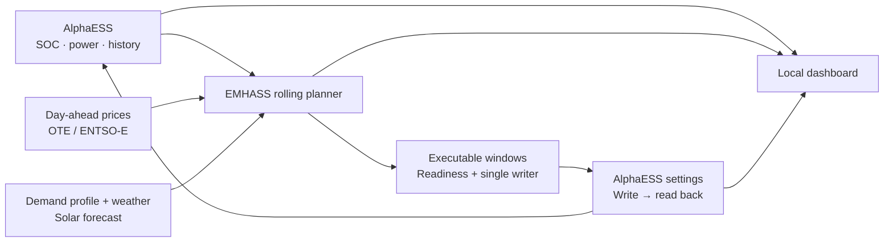

<div align="center">

# AlphaESS Energy Manager

**Your battery. Tomorrow’s prices. A plan that keeps adapting.**

[](pyproject.toml)
[](pyproject.toml)
[](https://github.com/michaelkrasa/alpha-ess-charging-optimizer/actions/workflows/tests.yml)
[](LICENSE)

A self-hosted battery manager that connects **[EMHASS](https://github.com/davidusb-geek/emhass)** rolling optimization to **AlphaESS**, day-ahead electricity prices and a clear, tablet-friendly dashboard. No Home Assistant required.

[Explore the demo](https://michaelkrasa.github.io/alpha-ess-charging-optimizer/) · [Get started](#get-started) · [Deployment](#run-it-your-way) · [Adapt with AI](docs/ADAPTING.md) · [Roadmap](analysis/project_roadmap.md)

### [Open the interactive dashboard →](https://michaelkrasa.github.io/alpha-ess-charging-optimizer/)

Full-size charts. Today and tomorrow. Try the controls. **Synthetic data; no account required.**

</div>

Charge when the expected savings justify it. Keep energy for expensive periods. Leave room for solar. Replan every **15 minutes** from measured SOC, published prices, household demand and a weather-based PV forecast.

**EMHASS does the optimization.** This project adds AlphaESS control, executable schedule translation, confirmation, history and the dashboard. Prices come from OTE or ENTSO-E; calculations and displays use EUR.

## See the plan, see what’s set

| At a glance | Through the day |
| --- | --- |
| Battery charge, measured activity and solar output | Today/tomorrow prices on a linear scale |
| Automatic management ON/OFF and connection freshness | Proposed actions beside settings read back from the inverter |
| Next import price, daily min/max/mean | Expected vs measured battery charge, quarter-hour deltas |
| Short daily plan summaries | Solar and site demand filling in from midnight |

[Explore the dashboard in your browser →](https://michaelkrasa.github.io/alpha-ess-charging-optimizer/) Switch days, inspect prices, expand the schedule, and try ON/OFF. The sample uses the real dashboard with synthetic data. It works on desktop, tablet and phone, and can be downloaded as one self-contained HTML file.


## How it works



The planner accounts for battery capacity, reserve, efficiency, assumed wear and forecast solar. The controller translates the next action into the inverter’s supported windows and checks the stored configuration. **Settings confirmed** means readback matched; timestamped measured power is the evidence of physical activity. Historical simulations are evidence for comparing policies, not promised savings.

## Get started

Requires Python 3.12–3.13 and [uv](https://docs.astral.sh/uv/).

```bash
git clone https://github.com/michaelkrasa/alpha-ess-charging-optimizer.git
cd alpha-ess-charging-optimizer
cp .env.example .env
cp examples/manager.yaml manager.local.yaml
cp examples/solar_config.yaml solar.local.yaml
chmod 600 .env
# Fill .env credentials, battery/tariff settings and solar geometry.
uv sync --frozen --extra emhass --extra dev
uv run --extra emhass python main.py --config manager.local.yaml serve --host 127.0.0.1
```

Open **[localhost:8765](http://127.0.0.1:8765)**. This starts in observation mode. Live control requires commissioning, `--live`, and the dashboard switch ON; a fresh database starts OFF. [Setup and commissioning →](docs/SETUP.md)

## Run it your way

| Where | Path | Status |
| --- | --- | --- |
| Computer / Linux server | Python + uv | Local operation supported |
| Synology or another NAS | Docker Compose + persistent SQLite | ARM64 full-horizon replay and live control [verified](analysis/nas_solver_validation.md) |
| Raspberry Pi | 64-bit OS + Docker Compose | Same ARM64 target; hardware performance still needs validation |
| AWS Lambda | Lambda/SAM + DynamoDB | Packaging scaffold exists; current EMHASS deployment is **experimental**, not a turnkey/free guarantee |

**Docker is the simplest always-on option.** [Container / NAS setup](NAS.md) · [AWS status](docs/DEPLOYMENT.md)

For an already commissioned Synology installation, [authorize the fixed updater once](NAS.md#one-time-authorization). Future updates need one command and no password prompt; it tests and builds locally, backs up state, deploys, and checks a fresh controller cycle:

```bash
./scripts/deploy-nas.sh --host YOUR_USER@YOUR_NAS
```

Credentials are supplied at runtime, never baked into the image. Keep the passwordless local dashboard on a trusted LAN; use a VPN or authenticated proxy for remote access. Run one live controller per inverter.

## Compatibility today

AlphaESS cloud API support includes standard two-charge/two-household-discharge windows, rewritten throughout the day. Weekly scheduling needs separate device permission; a `6017` response does not rule out the standard API. Current battery discharge semantics supply household loads; forced battery export is not implemented.

OTE and ENTSO-E inputs exist, but **tariff calculations and scheduling still include Czech/Prague assumptions**. Another bidding zone alone is not complete international support. Battery power, capacity, tariffs and EV treatment must match your installation. [Limits and commissioning](docs/SETUP.md#before-live-control)

## Built to adapt

Use your coding assistant to tailor an installation or add an adapter: [AI adaptation guide](docs/ADAPTING.md). It maps the code, assumptions, test commands and evidence needed before live writes. AI helps make changes; a deterministic controller and EMHASS run the battery.

The direction is a small integration layer around established planners, with explicit inverter capabilities and separate price/tariff providers. Before expanding, compare with EMHASS, evcc and Predbat. [Overlap assessment and phased roadmap →](analysis/project_roadmap.md)

## Development and validation

```bash
uv run --frozen --extra emhass --extra dev pytest tests/ -q
```

The suite covers actual EMHASS solves, executable battery physics, price intervals, forecasts, control/readback failures and dashboard behavior. [Walk-forward validation](analysis/emhass_validation.md) · [Analysis guide](analysis/README.md) · [Contributing](CONTRIBUTING.md)

**Version 1.1.0.** `uv.lock` pins the environment; the EMHASS adapter targets **0.18.6**. Dependabot is configured for weekly Python, Docker and Actions update proposals. Dependency changes need tests and, for the planner, replay validation; they are not automatically installed on an inverter controller.

Licensed under [MIT](LICENSE). Thanks to [EMHASS](https://github.com/davidusb-geek/emhass), [alphaessopenapi](https://github.com/CharlesGillanders/alphaess-openAPI), [OTE price fetcher](https://pypi.org/project/ote-cr-price-fetcher/) and [Open-Meteo](https://open-meteo.com/).
