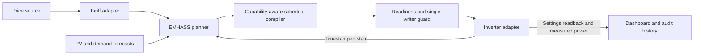

# Project direction

Research checked **22 October 2026**. This is a proposal, not a list of shipped features.

**Keep a focused, standalone bridge between EMHASS, real inverter capabilities and an understandable dashboard. Expand only when another installation proves the need.** The useful contribution is making a plan executable and observable; maintaining another optimization engine would duplicate existing work.

## What already exists here

The current integration uses EMHASS rolling optimization, AlphaESS cloud telemetry/control, OTE or ENTSO-E published prices, weather-based PV forecasts, measured demand profiles, SQLite and a local dashboard. The controller translates plans to supported schedule windows and verifies settings by reading them back. See [validation](emhass_validation.md) for the scope and limits of historical comparisons.

This is still an **AlphaESS/Czech deployment**, not a generic European energy platform. `Providers.market()` accepts an ENTSO-E bidding-area identifier, but `domain.py` and tariff calculations still use Prague time, and `tariff.py` contains a particular Czech contract. The EMHASS appliance adapter currently requires standard daily window controls. Broader claims need more work and hardware evidence.

## Build versus integrate

| Existing project | Overlap and decision |
| --- | --- |
| [EMHASS](https://emhass.readthedocs.io/en/latest/study_cases/mpc.html) | Already provides rolling optimization from refreshed SOC, forecasts and prices. **Keep it as the planner dependency.** Contribute reusable appliance constraints upstream where appropriate; keep protocol translation and readbacks here. EMHASS uses an [MIT license](https://github.com/davidusb-geek/emhass/blob/master/LICENSE). |
| [evcc](https://docs.evcc.io/en/features/battery/) | Already provides battery grid charging, discharge blocking and substantial device integration. Its [AlphaESS SMILE adapter](https://docs.evcc.io/en/meters/alpha-ess-storion-smile/) documents active control over Modbus, which is a different path from this cloud adapter. Prefer evcc for a supported EV-focused installation rather than rebuilding charger orchestration. |
| [evcc optimizer](https://docs.evcc.io/en/features/optimizer/) | Strong future overlap: forecasts, household demand, battery planning and a separately self-hostable optimizer. The checked docs explicitly describe predictive control as **informational only** at present; ordinary evcc battery controls already work. Re-evaluate before adding a second inverter ecosystem here. [Optimizer source](https://github.com/evcc-io/optimizer). |
| [Predbat](https://springfall2008.github.io/batpred/inverter-setup/) | Already covers many inverter brands and now documents experimental direct AlphaESS cloud support, including limited-window fallback. Its AlphaESS section says hardware behavior has not been verified by its maintainers. Compare on the same installation in read-only mode and share sanitized findings. Its [current license notice](https://springfall2008.github.io/batpred/) restricts use to personal use: do not assume its code is permissively reusable. |
| [alphaess-openAPI](https://github.com/CharlesGillanders/alphaess-openAPI) | Keep vendor authentication and API access in the existing library. Contribute corrected protocol behavior and tests there rather than growing a private SDK fork. |

Recommendation: continue this small integration now, while treating consolidation as a successful outcome. If an existing project meets the same hardware, tariff, privacy and usability requirements with less maintenance, migrate and retain this repository as an adapter, dashboard or commissioning toolkit.

## A credible path to broader support

These boundaries describe a target architecture. They are not a plugin API already implemented in this repository.

| Phase | Deliverable | Exit criterion before expanding |
| --- | --- | --- |
| **1. Reliable public baseline** | Generic examples, dashboard demo, reproducible releases, dependency update PRs, public tests and sanitized replay fixtures. Explicit solver/runtime health and recovery behavior. | A new user can start read-only without private files; supported hardware completes a full published-price horizon within its budget; restart/outage tests preserve the single writer. |
| **2. European prices and tariffs** | Separate market data from the actual import/export contract. Make bidding area, local timezone, supplier fees, taxes, distribution windows and effective dates installation inputs. Keep internal money in EUR. | A second country/contract works through configuration with independently checked bills and price intervals; tests cover negative prices, missing publication and 23/25-hour days. |
| **3. One additional inverter** | Define a small capability contract and implement one maintained adapter with an actual device owner. Compare evcc/Predbat integration effort first. | A second physical inverter passes read-only commissioning, schedule/readback and failure tests without duplicating the planner/controller. No generic-brand marketing before that. |
| **4. Deployment choices** | Versioned container images and a common persistent service for computers, compatible NAS devices and 64-bit Raspberry Pi. Treat Lambda as a separate deployment target. | Clean install/update/rollback proven on each advertised architecture. Lambda needs durable state, locking, secure dashboard access and a packaged solver demonstrated end to end; never promise permanently free AWS operation. |
| **5. Measured value** | Compare forecast accuracy, execution and realized costs against native self-consumption and simple daily scheduling. Prefer dedicated EV metering over uncertain inference. | Walk-forward reports and measured outcomes distinguish battery value from the incremental value of this controller, with losses, wear and retained energy accounted for. Add learned forecasts only when they improve held-out decisions. |

ENTSO-E publishes market prices, not an installation's final retail tariff. Its API uses price document type A44 and requires access credentials; provider adapters must preserve interval timestamps/resolution and verify coverage. See the official [API extraction guide](https://transparency.entsoe.eu/content/static_content/download?path=%2FStatic+content%2Fweb+api%2FIG-for-TP-data-extraction-process.pdf) and [token management guide](https://transparency.entsoe.eu/content/static_content/download?path=%2FStatic+content%2FAPI-Token-Management.pdf). Do not silently invent tomorrow's prices or apply one country's VAT/distribution fees to another area.

An inverter capability record should distinguish telemetry freshness; power setpoints versus simple enable windows; household-supply permission versus forced export; window count/resolution; midnight/DST behavior; SOC target/reserve semantics; write pacing; configuration confirmation; and native fallback. Unsupported actions must be rejected before optimization or compilation. Grid-only EV load stays in site billing while remaining separate from battery-service demand.

## Easy for people and their coding agents

Make adaptation discoverable: a short entry-point map, configuration schema, synthetic fixtures, an adapter recipe, and commands for read-only probing, replay, contract checks and previewing the dashboard. Provide a starter prompt that points an agent to those resources and asks it to demonstrate compatibility before enabling writes. Secrets and household history must not be required to understand or test the project.

AI can help users implement adapters, explain plans and review changes. The live loop should remain reproducible: timestamped inputs → external mathematical planner → validated device commands → readback. An LLM should not improvise live actuation or disable readiness checks.

## When to stop building a platform

Before each new integration, compare the work with contributing it to EMHASS/evcc or using Predbat. If there is no second device owner, keep the seam documented and postpone abstraction. If an existing maintained stack passes the same commissioning/replay requirements and provides the desired dashboard, choose that stack. A small well-tested AlphaESS bridge is a useful project; a duplicate universal energy platform is not the goal.
